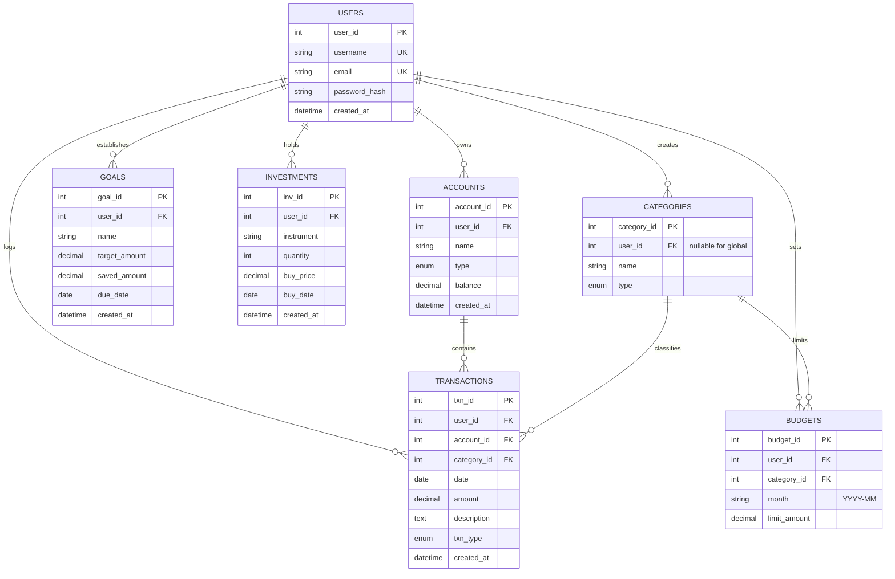

# AI-Based Personal Finance & Investment Management System

A web-based personal finance, budgeting, and investment tracking system featuring machine learning spending forecasting, statistical anomaly detection, and NLP transaction auto-categorization.

Built following the capstone specification with Python Flask, MySQL / SQLite via SQLAlchemy ORM, Bootstrap 5, Chart.js, and Scikit-Learn.

---

## 🚀 Key Features

1. **User Authentication & Session Management**:
   - Secure account registration & login powered by `Flask-Login` and `Werkzeug` secure password hashing.
   - Session isolation ensuring each user sees only their accounts, budgets, and transactions.

2. **Core Financial & Transaction Ledger (CRUD + CSV)**:
   - Atomic balance updates (ACID transaction property): adding, editing, or deleting an expense or income dynamically updates account balances.
   - Advanced transaction filtering by date range, account, category, type, and keyword search.
   - Batch CSV import with automated column normalization and AI auto-categorization.
   - One-click CSV export.

3. **Multi-Account & Portfolio Holdings**:
   - Manage multiple accounts (Checking, Savings, Credit, Cash) with real-time liquid balance calculation.
   - Investment portfolio tracker calculating position cost basis (`quantity × buy_price`) and visual asset allocation.

4. **Budgets & Milestone Savings Goals**:
   - Monthly category budgets with live utilization percentages and progress bars (Query A).
   - Milestone savings goals (Query C) with deadline tracking and "Contribute Funds" quick transfer modals.

5. **AI Advisory & Analytics Hub (Scikit-Learn & Heuristic Engine)**:
   - **Predictive Spending Forecaster**: Scikit-Learn `LinearRegression` time-series projection estimating future monthly spending with evaluation metrics (MAE, RMSE, slope direction).
   - **Real-time NLP Categorizer**: Scikit-Learn `Pipeline` (`TfidfVectorizer` + `MultinomialNB`) suggesting categories in real-time as users type transaction descriptions.
   - **Mid-Month Pacing Warnings**: Proactive heuristic rules flagging categories projected to overrun their monthly limits.
   - **Statistical Anomaly Detection**: Outlier detection identifying expenses exceeding 2 standard deviations above the category norm.
   - **Ethical AI Disclaimer**: Transparent advisory notices aligned with Intuit AI financial safety guidelines.

---

## 📐 Database Schema & Architecture



---

## 🛠️ Technology Stack

- **Backend**: Python 3.11+, Flask 3.1+, Flask-SQLAlchemy 3.1+, Flask-Login 0.6+, Werkzeug 3.1+
- **Database**: MySQL 8.x / 9.x (InnoDB engine) with automatic zero-configuration fallback to SQLite for local development
- **AI & Analytics**: Scikit-Learn 1.3+, Pandas 2.0+, NumPy
- **Frontend**: HTML5, Bootstrap 5.3, Bootstrap Icons, Chart.js 4.x via CDN
- **Testing**: Pytest

---

## ⚡ Quickstart Guide

### 1. Installation
Clone or navigate to the project directory:
```bash
cd ai-finance-manager
pip install -r requirements.txt
```

### 2. Initialize and Seed the Database
Populates standard global categories, sample accounts, test users (`alice` and `bob`), realistic multi-month transactions, budgets, goals, and investments:
```bash
python seed_data.py
```

### 3. Run the Development Server
```bash
python app.py
```
Open your browser and navigate to: **`http://localhost:5000`**

### 4. Demo Login Credentials
- **Username**: `alice` | **Password**: `password123`
- **Username**: `bob` | **Password**: `password123`

---

## 🧪 Running Automated Tests

A test suite verifying authentication, atomic balance adjustments, budget queries, edge-case alert triggers, and ML categorizer accuracy:
```bash
python -m pytest -v
```

---

## 🐳 Docker & MySQL 8.0 Deployment

To deploy using Docker Compose with dedicated MySQL 8.0 and Flask containers:
```bash
docker-compose up --build
```
This automatically boots MySQL 8.0 on port 3306, applies `sql/schema.sql` and `sql/sample_data.sql`, and starts the Flask web service on port 5000.

---

## 📂 Project Directory Structure

```text
ai-finance-manager/
├── app.py                   # Main Flask application and REST controllers
├── models.py                # SQLAlchemy ORM database models (3NF)
├── config.py                # Application environment configuration
├── ai_engine.py             # Heuristic rules, ML forecasting, and NLP categorizer
├── seed_data.py             # Database initialization and sample data seeder
├── test_app.py              # Automated Pytest test suite
├── requirements.txt         # Python dependencies
├── Dockerfile               # Multi-stage production container definition
├── docker-compose.yml       # Multi-container orchestration (App + MySQL 8.0)
├── .env.example             # Template for environment variables
├── sample_import.csv        # Ready-to-use sample CSV for testing file imports
├── sql/
│   ├── schema.sql           # MySQL 8.x DDL schema creation script
│   ├── sample_data.sql      # Reference SQL INSERT statements
│   ├── queries.sql          # Section 8.1 Key analytical queries (A, B, C, D)
│   └── stored_procedures.sql# Section 8.2 Stored procedures (monthly_summary)
├── static/
│   └── css/
│       └── style.css        # Custom fintech styling
└── templates/
    ├── base.html            # Core layout with Bootstrap 5 navbar and notifications
    ├── login.html           # Secure user login
    ├── register.html        # User registration
    ├── dashboard.html       # Chart.js analytics dashboard and financial summary
    ├── transactions.html    # Transactions ledger with filtering & CSV modal
    ├── add_transaction.html # Transaction form with real-time AI auto-suggest
    ├── edit_transaction.html# Transaction edit form
    ├── accounts.html        # Accounts management
    ├── categories.html      # Category management
    ├── budgets.html         # Budget vs actual spending tracker
    ├── goals.html           # Savings goals & contribution modals
    ├── investments.html     # Investment portfolio & allocation chart
    └── recommendations.html # AI Advisory Hub (Forecast, Anomalies, ML Sandbox)
```
